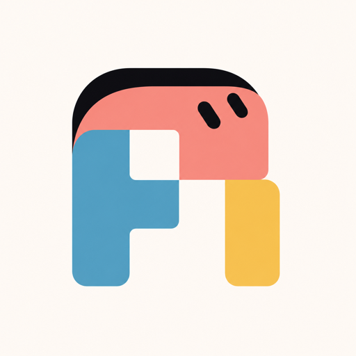
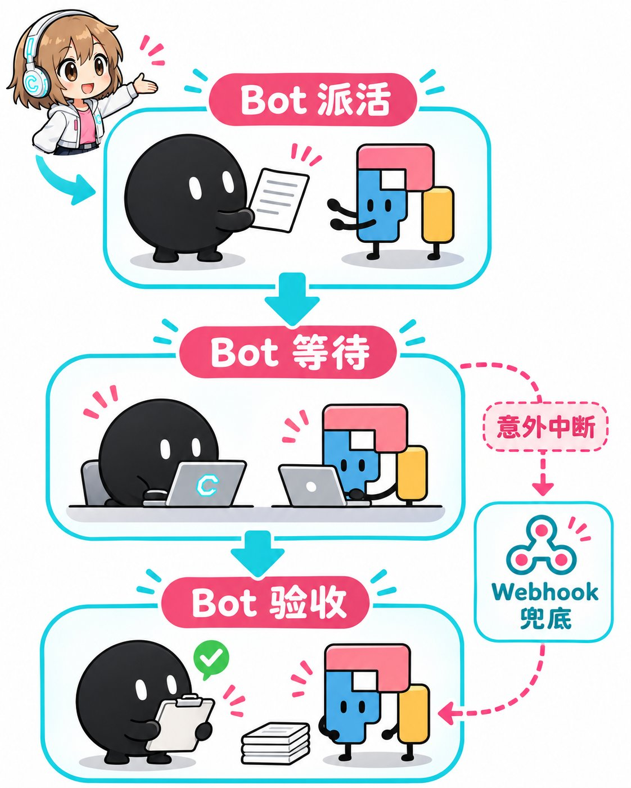
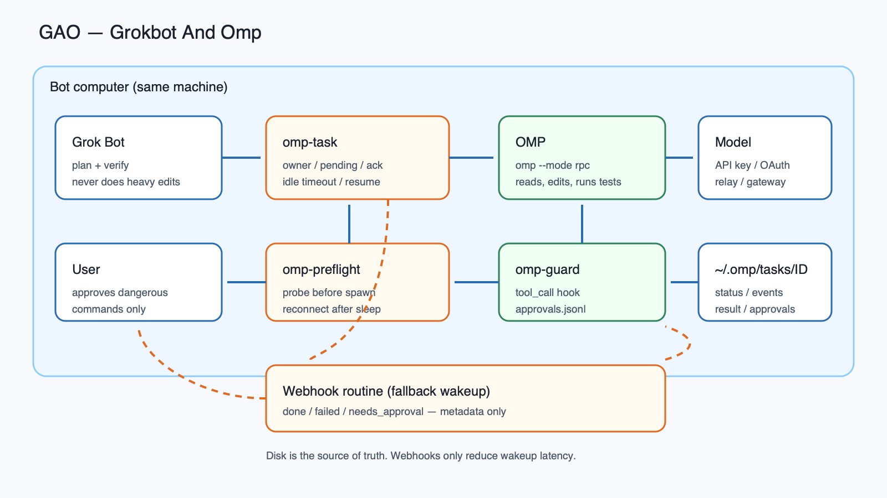
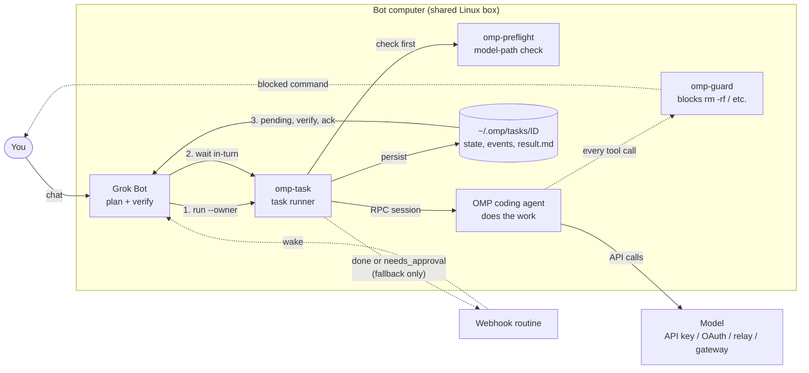

<p align="center">
  
</p>

<h1 align="center">GAO — Grokbot And Omp</h1>

English | [简体中文](README.zh-CN.md)

Let Grok Bot delegate heavy coding, batch file editing, and long document processing to a local **OMP coding agent** ([omp.sh](https://omp.sh), Oh My Pi) running as a subagent on the same computer, keeping Grok Bot quota focused on planning and verification.

GAO is the OMP counterpart of [GAP (Grokbot And Pi)](https://github.com/Chasen-Liao/grokbot-and-pi). The task model, owner routing, approval loop, notification payloads, and Bot behavior are functionally equivalent; only the runtime, paths, environment prefixes, and RPC/CLI adaptation differ.

---

## Why GAO?

- **Save expensive Grok Bot quota**: Cloud bot allowances are costly and best spent on reasoning, task decomposition, and code review. Delegating multi-step execution (reading repositories, editing files, running tests) to OMP consumes your own model accounts (official API keys, OAuth, custom relays, local defaults, or private gateways).
- **Keep execution local and fast**: OMP runs on the same cloud machine where the Bot operates, with direct access to local files and bash tools—no cross-network file syncing needed.
- **Reliable tracking and verification**: Unattended coding agents can freeze on machine sleep, hang on broken connections, or make wild assumptions. GAO provides a persistent task manager (`omp-task`), preflight connection recovery, idle-timeout guards, disaster prevention (`omp-guard`), and human-in-the-loop approvals.
- **OMP-native RPC**: GAO speaks `omp --mode rpc` directly: protocol v2 negotiation with chunk reassembly, `prompt_result` completion, session file resume, and the `tool_call` extension hook.

---

## Architecture & Closed-Loop Workflow

<p align="center">
  
</p>

<p align="center">
  
</p>

### Architecture



GAO operates as a closed 4-step loop:

1. **Dispatch (`omp-task run`)**: Grok Bot drafts a concise, self-contained task specification and launches it in the background using `omp-task run <dir> '<prompt>' --session <name> --owner <BOT_ID> --notify-prefix <BOT>`.
2. **Wait in-turn (avoid sleep freeze)**: The Bot **does not exit the current turn**. Because cloud agent host machines often sleep or restart when idle (which freezes or kills background worker processes), the Bot holds an extended blocking wait (`AwaitShell`, up to ~13 minutes) until OMP finishes. Waiting in-turn consumes virtually zero Bot model quota while keeping the machine awake.
3. **Webhook as fallback**: If the conversation turn does end prematurely, `omp-task` sends a lightweight HTTP POST notification (`{source, id, owner, state, exit_code}`) to the Bot's webhook routine upon completion or when an approval is required (`needs_approval`).
4. **Inspect, report, and Ack**: The Bot inspects `~/.omp/tasks/<ID>/result.md`, verifies git diffs, file artifacts, and test outputs first-hand, reports the findings to the user, and acknowledges the task with `omp-task ack <ID> --owner <BOT_ID>`.

> **Disk is the single source of truth**: All status records, event streams, and results are persisted under `~/.omp/tasks/<ID>/`. Webhooks are strictly a wake-up mechanism. If a notification packet drops, the Bot recovers all unreported outcomes simply by checking `omp-task pending --owner <BOT_ID>`.

### Scope and non-goals

- OMP stays on the **same machine** as the Bot; GAO does not implement a remote worker.
- GAO is not a strong sandbox. `omp-guard` is a narrow disaster guard; use OMP's sandbox extensions or OS isolation when you need real containment.
- Irreversible actions (delete important data, payments, public posts, email, `git push`, production deploys) remain with the Bot/user, never delegated.
- GAO deliberately uses separate paths, env prefixes and session storage from GAP so both can coexist.

---

## Quick Start

### 1. Automated Setup with Grok Bot (Recommended)

Send this repository link to your Grok Bot and ask it to configure itself following [AGENTS.md](AGENTS.md):

```text
Please read AGENTS.md at https://github.com/yuehen7/grokbot-and-omp and set up GAO for me.
```

The Bot will verify Node.js (>= 22), install or check OMP, help configure your model source and Webhook routine, register skills, and run a smoke test.

### 2. Manual Installation

If you prefer to install manually on the Bot host:

```bash
# 1. Ensure Node.js >= 22 and OMP is installed
node -v                 # must be >= 22
curl -fsSL https://omp.sh/install | sh
omp --version
omp -p 'Reply with only OK' --no-session

# 2. Clone this repository and run the safe installer (installs to ~/tools/omp-call)
git clone https://github.com/yuehen7/grokbot-and-omp /tmp/grokbot-and-omp
cd /tmp/grokbot-and-omp
./install.sh

# 3. Add tools to PATH (optional, e.g. in ~/.bashrc)
export PATH="$HOME/tools/omp-call:$PATH"

# 4. Verify the CLI
~/tools/omp-call/omp-task --help
```

---

## Daily Use

Grok Bot uses `omp-task` to manage delegated tasks. Key commands:

```bash
# 1. Dispatch a background task (always include --owner)
~/tools/omp-call/omp-task run /workspace/project "Refactor auth middleware and add tests" \
  --session auth-refactor \
  --owner YOUR_AGENT_ID \
  --notify-prefix GROKBOT \
  [--model provider/model] [--thinking medium] [--timeout 1800]

# 2. Follow up or resume in the same OMP session
~/tools/omp-call/omp-task reply TASK_ID "Also cover the token expiration edge case" --owner YOUR_AGENT_ID

# 3. Check status, view recent logs, or cancel
~/tools/omp-call/omp-task status TASK_ID
~/tools/omp-call/omp-task log TASK_ID -n 30
~/tools/omp-call/omp-task cancel TASK_ID

# 4. Find pending tasks and acknowledge after first-hand verification
~/tools/omp-call/omp-task pending --owner YOUR_AGENT_ID
~/tools/omp-call/omp-task ack TASK_ID --owner YOUR_AGENT_ID

# 5. Handle approval requests intercepted by omp-guard (User decision only!)
~/tools/omp-call/omp-task approve TASK_ID REQ_ID --owner YOUR_AGENT_ID
~/tools/omp-call/omp-task deny TASK_ID REQ_ID --owner YOUR_AGENT_ID
```

### Writing a Good Task Specification

Grok Bot task specifications should be concise and strictly bounded:
1. **Goal**: What to do in 1-2 sentences with necessary context (OMP cannot see chat history).
2. **Artifact Path**: Absolute destination path for modified or created files.
3. **Definition of Done**: Clear, checkable acceptance criteria (e.g. tests pass, exports added).
4. **Strict Boundary**: E.g. *"Only edit files in `/workspace/project/src`. Do NOT delete any files. Do NOT git push."*
5. **Self-check**: *"Perform one self-check after implementation and stop; do not repeat checks endlessly."*

---

## Reliability & Resilience

- **Host Sleep & Restart Recovery**:
  Cloud Bot hosts sleep when idle, freezing OMP. By waiting in-turn using blocking `AwaitShell`, tasks complete without host sleep interruptions. If a host reboot interrupts an active job, `omp-task status` detects the orphaned PID and marks it `interrupted`. The Bot clears old state with `omp-task cancel <ID>` and resumes seamlessly using `omp-task reply <ID> 'The machine rebooted; please resume where you left off...' --owner <BOT_ID>`.
- **Session Resume**:
  A fresh run creates an OMP session under `~/.omp/agent/sessions/tasks` (override with `OMP_TASK_SESSION_DIR`). `omp-task` records `session_file` from the RPC `get_state` response and `reply`/`approve`/`deny` resume that exact file with `--resume`, preserving context.
- **Preflight Model Path Health Check (`omp-preflight`)**:
  When waking from sleep, network connections (such as Tailscale tunnels) often accept TCP connections but hang on HTTP requests until failing with `UND_ERR_SOCKET`. Copy `bin/omp-preflight.example` to `~/tools/omp-call/omp-preflight` and adjust your health probe: `omp-task` automatically runs preflight before `run`, `reply`, `approve`, and `deny`, restarting network tunnels if unhealthy. When OMP auto-retries a connection error, `omp-task` reruns preflight in parallel.
- **Idle Timeout Protection**:
  If OMP stops emitting RPC events for 300 seconds (configurable via `--idle-timeout <seconds>` or `OMP_TASK_IDLE_TIMEOUT`), `omp-task` terminates the task with state `failed` (reason `idle timeout`) and sends a notification, preventing infinite hangs on dead model sockets.
- **Flexible Model Quotas**:
  OMP works with any model provider. Pass `--model <provider/model>`, configure `OMP_TASK_MODEL`, or let OMP use its native default model and quota. If self-hosting a translation gateway such as Magpie on a VPS, **bind exclusively to Tailscale private IP addresses with authentication enabled—never expose ports to the public internet** (see [docs/quota.md](docs/quota.md)).

---

## Safety & Boundaries

- **Disaster Prevention Extension (`omp-guard`)**:
  Installed by default in `extensions/omp-guard.ts` and loaded by `omp-task` through OMP's `-e/--extension` flag. `omp-guard` narrowly intercepts catastrophic operations, including recursive deletes on system roots, user homes, or wildcards (`rm -rf /`, `/workspace`, `*`, `~`), `find -delete` on root/home, `mkfs`, and `dd of=/dev/`. Safe project builds (`rm -rf ./build`, `node_modules`) pass freely.
- **Human-in-the-Loop Approval Workflow**:
  When a dangerous command is intercepted, `omp-guard` logs it to `approvals.jsonl` with a unique request ID (`req`) and `omp-task` notifies the Bot with `state: "needs_approval"`. **The Bot must present the command to the user and is strictly forbidden from approving on its own.** Only after the human user explicitly agrees does the Bot run `omp-task approve <ID> <req> --owner <BOT_ID>`.
- **Restricted Operations Never Delegated to OMP**:
  Deleting important files, sending emails or external messages, online payments, public social posts, and `git push` **must never be handed to OMP**. Grok Bot handles these sensitive actions directly after separate user confirmation.
- **Secret Hygiene**:
  Notification credentials (`<BOT>_OMP_NOTIFY_URL`, `<BOT>_OMP_NOTIFY_KEY`) are stripped from the OMP child process, and OMP's own credential store (`~/.omp/agent/`) must never be read or printed. Notification payloads contain no prompt, result, or secrets.
- **Minimal Working Directory**:
  Dispatch into a project directory or `/tmp/<name>`, never `/`, the whole `$HOME`, or the `/workspace` root.

---

## Repository Layout

```text
grokbot-and-omp/
├── AGENTS.md                  # 7-step guide for Grok Bot automated self-configuration
├── bin/
│   ├── omp-task               # Main CLI wrapper with preflight support
│   ├── omp-task.mjs           # Task lifecycle runner (OMP RPC, events, owner, approvals)
│   ├── omp-call.mjs           # Low-level one-shot RPC client
│   ├── omp-run                # Synchronous quick-run wrapper
│   └── omp-preflight.example  # Example network/gateway health probe & reconnect script
├── extensions/
│   └── omp-guard.ts           # Lightweight disaster prevention extension (tool_call hook)
├── skills/
│   ├── grokbot-omp-setup/     # Skill for initial environment and connectivity setup
│   └── grokbot-omp-dispatch/  # Skill for task writing, dispatch, monitoring, and ack
├── routines/
│   └── omp-task-notify.md     # Webhook Routine prompt template for Grok Bot
├── docs/
│   ├── architecture.png       # Architecture diagram
│   ├── architecture.svg       # Editable diagram source
│   ├── workflow.jpg           # Illustrated workflow
│   ├── logo.png               # Project icon
│   ├── quota.md               # Model quota setup (official API, OAuth, relays, Magpie gateway)
│   ├── security.md            # omp-guard specifications and human approval workflow
│   ├── setup-guide.md         # Detailed lifecycle, storage, session and manual setup guide
│   ├── omp-task-reference.md  # Complete omp-task CLI, RPC and environment reference
│   └── grokbot-and-omp-design.md
├── tests/
│   └── omp-guard.test.mjs     # Test suite for omp-guard interception rules
├── install.sh                 # Safe non-destructive installer
└── LICENSE                    # MIT License
```

---

## Documentation

- [Model Quota Setup Guide](docs/quota.md) — Official API keys, OAuth, OpenAI relays, and private Magpie gateways.
- [Security & Guard Workflow](docs/security.md) — `omp-guard` rule definitions and human-in-the-loop approvals.
- [Setup & Lifecycle Guide](docs/setup-guide.md) — Comprehensive environment configuration, session storage, and task store internals.
- [omp-task CLI Reference](docs/omp-task-reference.md) — CLI flags, OMP RPC adaptation, subcommands, exit codes, and environment variables.
- [Webhook Routine Template](routines/omp-task-notify.md) — Copy-paste prompt for configuring the Bot's Webhook Routine.
- [Design Document](docs/grokbot-and-omp-design.md) — Functional specification and GAP parity matrix.

---

## GAO and GAP on the same machine

GAO and [GAP](https://github.com/Chasen-Liao/grokbot-and-pi) can coexist:

| | GAP | GAO |
| --- | --- | --- |
| Agent binary | `pi` | `omp` |
| Task CLI | `pi-task` | `omp-task` |
| Install dir | `~/tools/pi-call` | `~/tools/omp-call` |
| Task store | `~/.pi/tasks` | `~/.omp/tasks` |
| Notify env | `<BOT>_PI_NOTIFY_*` | `<BOT>_OMP_NOTIFY_*` |

Skills should state explicitly whether the current dispatch target is Pi or OMP to avoid mixing commands.

---

## Reference & Acknowledgements

GAO is directly modeled on **[GAP — Grokbot And Pi](https://github.com/Chasen-Liao/grokbot-and-pi)**. Its task lifecycle, owner routing, Webhook notification contract, `pi-guard` rule set, approval workflow, and Bot behavior specification are the blueprint for this project. Sincere thanks to the GAP author and contributors — GAO would not exist without their work.

---

## Credits & License

Built upon the architecture of [robbin/grokbot-local-agent](https://github.com/robbin/grokbot-local-agent) and its Pi adaptation [GAP](https://github.com/Chasen-Liao/grokbot-and-pi), under the [MIT License](LICENSE). OMP is [omp.sh](https://omp.sh) / Oh My Pi.
