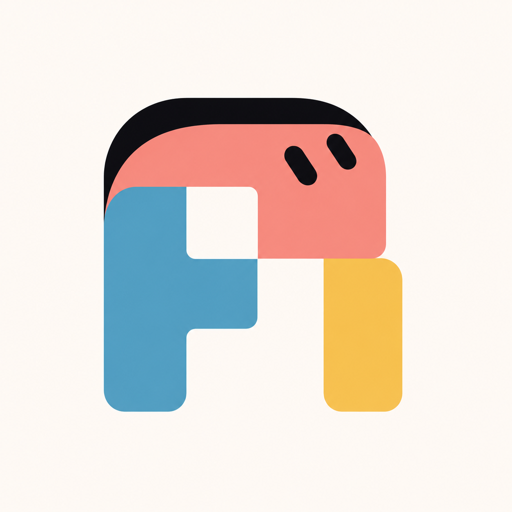
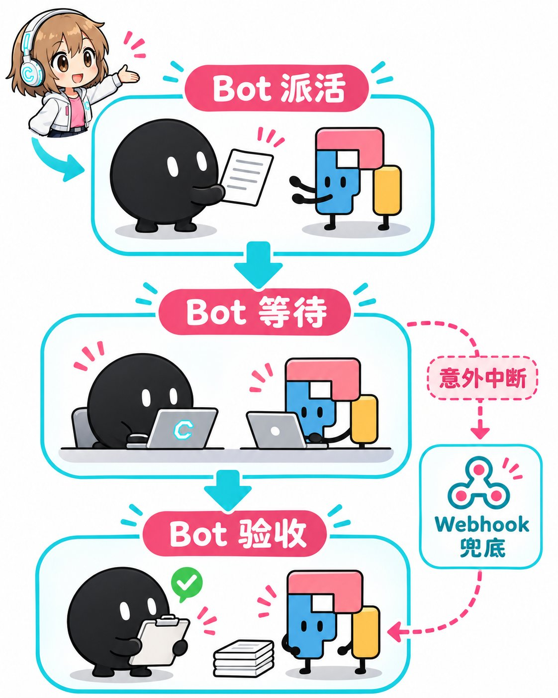
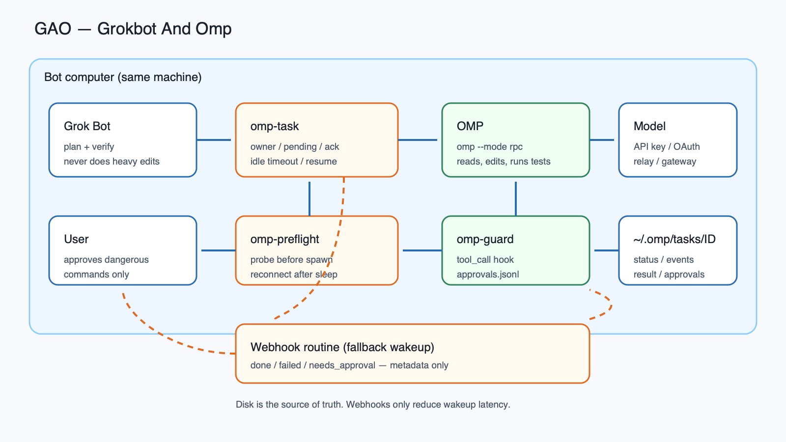
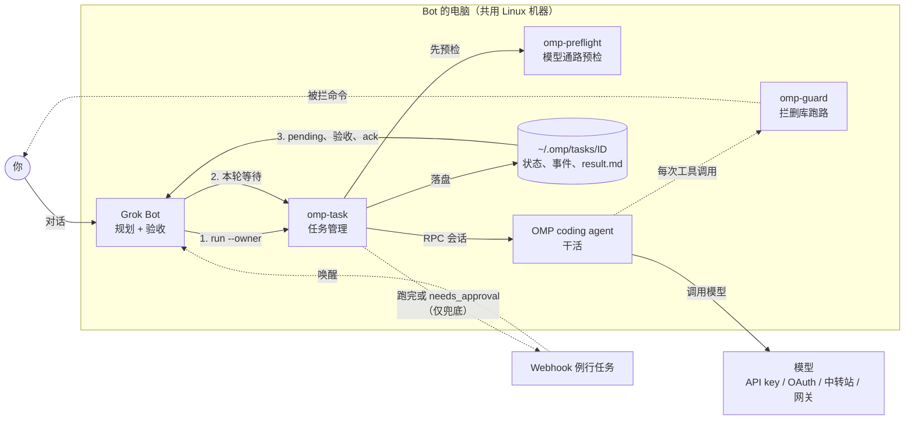

<p align="center">
  
</p>

<h1 align="center">GAO — Grokbot And Omp</h1>

[English](README.md) | 简体中文

让 Grok Bot 把繁重的代码编写、文件批量修改、长文档整理等执行活派给同机运行的 **OMP coding agent**（[omp.sh](https://omp.sh)，Oh My Pi）作为 subagent，把 Grok Bot 宝贵的额度集中在意图规划与结果验收上。

GAO 是 [GAP（Grokbot And Pi）](https://github.com/Chasen-Liao/grokbot-and-pi) 的 OMP 对标实现：任务模型、owner 路由、审批闭环、通知 payload 与 Bot 行为规范完全等价；差异仅在运行时、路径、环境变量前缀以及 RPC/CLI 适配层。

---

## 为什么需要 GAO？

- **节省 Grok Bot 昂贵额度**：平台对话配额昂贵，最适合用来做需求梳理、任务拆解与代码审查。将需要反复读文件、改代码、跑测试的多步执行活交给 OMP，消耗你自己配置的模型额度（官方 API Key、OAuth、第三方中转站、OMP 默认额度，或私有部署的网关）。
- **同机执行，速度快且无跨网开销**：OMP 直接运行在 Grok Bot 所在的云端 Linux 电脑上，直接读写本地文件与执行 bash，省去跨机器同步文件的复杂性。
- **高韧性追踪与严格验收**：无人值守的 coding agent 可能遇到机器休眠、网络中断或幻觉。GAO 提供了持久化任务管理（`omp-task`）、睡醒断网预检重连、空闲超时熔断、防删库扩展（`omp-guard`）以及人工审批闭环机制。
- **OMP 原生 RPC**：GAO 直接使用 `omp --mode rpc`：协议 v2 协商与大帧重组、`prompt_result` 完成判据、会话文件续跑，以及 `tool_call` 扩展钩子。

---

## 架构与闭环工作流

<p align="center">
  
</p>

<p align="center">
  
</p>

### 架构



GAO 包含清晰的 4 步闭环：

1. **Bot 派活（`omp-task run`）**：Grok Bot 编写简明且边界明确的任务书，通过后台模式启动 `omp-task run <工作目录> '<任务书>' --session <会话名> --owner <BOT_ID> --notify-prefix <BOT>`。
2. **本轮长等待（防宿主机休眠冻结）**：Bot 派发后**不要结束当前轮次**。因为云端电脑在 Bot 空闲时容易睡眠或重启（导致后台 OMP 进程被冻住或杀掉），Bot 在本轮用一次长时间阻塞的等待（例如 `AwaitShell`，单次最长约 13 分钟）等 OMP 执行完毕。阻塞等待几乎不消耗 Bot 模型额度，同时能保持宿主机唤醒。
3. **Webhook 唤醒兜底**：若由于不可抗力对话轮次提前结束，任务执行完毕或需要用户审批（`needs_approval`）时，`omp-task` 会在后台向设定的 Webhook 地址发起 HTTP POST 通知（仅包含 `{source, id, owner, state, exit_code}`，不含任务正文与敏感密钥），唤醒 Bot 的例行任务。
4. **亲自核验与确认（Ack）**：Bot 检查 `~/.omp/tasks/<ID>/result.md`，亲自运行 git diff、产物检查或单元测试，将核验证据汇报给用户，验收合格后运行 `omp-task ack <ID> --owner <BOT_ID>` 确认完成。

> **磁盘是唯一事实来源**：所有任务状态、事件流与最终产物均持久化保存在 `~/.omp/tasks/<ID>/`。Webhook 仅用于降低唤醒延迟；若网络抖动丢包，Bot 唤醒后运行 `omp-task pending --owner <BOT_ID>` 即可完整查回所有未报告的任务。

### 范围与非目标

- OMP 始终运行在 Bot 的**同一台机器**上；GAO 不做跨机远程 worker。
- GAO 不是强沙箱。`omp-guard` 只是极窄的灾难拦截；需要真正隔离时使用 OMP 官方 sandbox 扩展或系统级隔离。
- 不可逆操作（删除重要数据、付款、公开发帖、邮件、`git push`、生产部署）始终由 Bot/用户在确认后亲自执行，不派给 OMP。
- GAO 与 GAP 使用独立路径、环境变量前缀与会话存储，可同机并存。

---

## 快速开始

### 1. 发给 Grok Bot 自助配置（推荐）

只需把本仓库链接发给你的 Grok Bot，让它按 [AGENTS.md](AGENTS.md) 自动化配置：

```text
请阅读 https://github.com/yuehen7/grokbot-and-omp 的 AGENTS.md，帮我把 GAO 配置好。
```

Bot 会依序检查 Node.js（>= 22）、检查或安装 OMP、运行安装脚本、协助配置模型额度与 Webhook 唤醒 Routine、录入技能并完成冒烟测试。

### 2. 手动安装步骤

如果你希望在 Bot 所在机器上自行手动安装：

```bash
# 1. 确保 Node.js >= 22，并安装 OMP
node -v                 # 必须 >= 22
curl -fsSL https://omp.sh/install | sh
omp --version
omp -p 'Reply with only OK' --no-session

# 2. 克隆本仓库并执行安全安装脚本（默认安装到 ~/tools/omp-call）
git clone https://github.com/yuehen7/grokbot-and-omp /tmp/grokbot-and-omp
cd /tmp/grokbot-and-omp
./install.sh

# 3. 将工具目录加入 PATH（可选，如加入 ~/.bashrc）
export PATH="$HOME/tools/omp-call:$PATH"

# 4. 验证命令正常可用
~/tools/omp-call/omp-task --help
```

---

## 日常使用

Grok Bot 通过 `omp-task` 调度与跟踪任务，常用命令如下：

```bash
# 1. 后台派发任务（必须带 --owner）
~/tools/omp-call/omp-task run /workspace/project "重构鉴权中间件并补充单测" \
  --session auth-refactor \
  --owner YOUR_AGENT_ID \
  --notify-prefix GROKBOT \
  [--model provider/model] [--thinking medium] [--timeout 1800]

# 2. 追加要求或在原 OMP 会话续跑
~/tools/omp-call/omp-task reply TASK_ID "把 token 过期的边界条件也覆盖上" --owner YOUR_AGENT_ID

# 3. 查看状态、查看最新日志或取消任务
~/tools/omp-call/omp-task status TASK_ID
~/tools/omp-call/omp-task log TASK_ID -n 30
~/tools/omp-call/omp-task cancel TASK_ID

# 4. 查看未确认任务并在亲身核验后确认
~/tools/omp-call/omp-task pending --owner YOUR_AGENT_ID
~/tools/omp-call/omp-task ack TASK_ID --owner YOUR_AGENT_ID

# 5. 处理被 omp-guard 拦截的高危审批（必须由用户决断！）
~/tools/omp-call/omp-task approve TASK_ID REQ_ID --owner YOUR_AGENT_ID
~/tools/omp-call/omp-task deny TASK_ID REQ_ID --owner YOUR_AGENT_ID
```

### 任务书五要素

Grok Bot 派活时编写的任务书应当越精炼越好，包含五个关键要素：
1. **做什么**：一两句话讲清楚目标与必要背景（**OMP 无法看到聊天上下文**）；
2. **产物路径**：修改或生成文件的绝对路径；
3. **完成标准**：可量化核验的标准（如单测通过、导出对应接口）；
4. **严格边界**：如「只改 `/workspace/project/src` 目录，严禁删除任何文件，严禁 git push」；
5. **收尾规则**：「写完产物自查一次即结束，不要反复重试或无限自查」。

---

## 可靠性与韧性保障

- **宿主机睡眠与重启自动恢复**：
  Bot 所在电脑空闲时容易休眠，休眠会冻住 OMP。通过在派发轮次中保持阻塞等待（`AwaitShell`），可确保任务连贯执行不被休眠打断。若机器被突发重启打断，`omp-task status` 能自动识别孤儿进程并标记为 `interrupted`。Bot 仅需运行 `omp-task cancel <ID>` 清理旧状态，再用 `omp-task reply <ID> '电脑刚才重启了，请接着做剩下的工作…' --owner <BOT_ID>` 即可在原 OMP 会话中无缝续跑。
- **会话续跑**：
  新任务在 `~/.omp/agent/sessions/tasks`（可用 `OMP_TASK_SESSION_DIR` 覆盖）下创建 OMP 会话。`omp-task` 通过 RPC `get_state` 记录 `session_file`，`reply`/`approve`/`deny` 用 `--resume` 恢复同一会话，保留上下文。
- **模型链路预检（`omp-preflight`）**：
  电脑刚从睡眠唤醒时，虚拟网卡与转发链路（如 Tailscale）可能处于假死状态：本地端口看似可连，但 HTTP 请求挂起并在 2 分钟后报 `UND_ERR_SOCKET`。将 `bin/omp-preflight.example` 复制到 `~/tools/omp-call/omp-preflight` 并配好健康探测接口，`omp-task` 会在 `run`、`reply`、`approve`、`deny` 执行前自动执行预检，若链路不通则自动重启网络并等待就绪。OMP 遇到连接报错自动重试时也会并行拉起预检。
- **空闲超时熔断（`idle-timeout`）**：
  若 OMP 持续 300 秒（可通过 `--idle-timeout <秒数>` 或环境变量 `OMP_TASK_IDLE_TIMEOUT` 配置）未产生任何新的 RPC 事件，`omp-task` 会自动将其判为 `failed`（标记原因 `idle timeout`）并照常发送通知，防止任务因后端死锁无限期挂死。
- **多模型与额度灵活调度**：
  支持直接传入 `--model <provider/model>`、读取环境变量 `OMP_TASK_MODEL`，或直接采用 OMP 本地配置的原生默认模型。若在 VPS 上自建网关（如 Magpie）将网页配额转为 API，**务必仅监听 Tailscale 内网地址并启用 Token 认证，严禁向公网开放端口**（详见 [docs/quota.md](docs/quota.md)）。

---

## 安全防护与权限边界

- **防删库跑路扩展（`omp-guard`）**：
  内置在 `extensions/omp-guard.ts` 中并默认开启，由 `omp-task` 通过 OMP 的 `-e/--extension` 旗标显式加载。`omp-guard` 极窄拦截灾难性删除命令（如针对根目录、用户主目录、工作区或通配符的递归删除 `rm -rf /`、`/workspace`、`*`、`~`，以及危险的 `find -delete`、`mkfs`、底层覆写 `dd of=/dev/`）。项目的正常构建清理（如 `rm -rf ./build`、`node_modules`）完全放行。
- **人机协同审批闭环（`needs_approval`）**：
  当 OMP 尝试执行被拦截的命令时，命令被暂存并分配唯一请求号（`req`），Webhook 向 Bot 发送 `state: "needs_approval"` 通知。**Bot 必须将命令原样展示给人类用户，严禁擅自审批放行。** 只有当用户明确同意放行后，Bot 才执行 `omp-task approve <ID> <req> --owner <BOT_ID>`。
- **高危不可逆操作严禁派给 OMP**：
  文件删除、发送消息/邮件、在线付款、公开发帖、代码库推送（`git push`）、生产部署等高风险操作**绝对不交给 OMP**。必须在任务完成并由用户确认后，由 Grok Bot 亲自执行。
- **敏感凭证防泄漏**：
  通知密钥（`<BOT>_OMP_NOTIFY_URL`、`<BOT>_OMP_NOTIFY_KEY`）在启动 OMP 子进程前会被彻底清除，严禁将其打印到聊天框或持久化到任务日志中；OMP 自身凭据库（`~/.omp/agent/`）禁止 Bot 读取或打印。
- **工作目录最小化**：
  派活目录选项目目录或 `/tmp/<名>`，禁止 `/`、整个 `$HOME` 或 `/workspace` 根。

---

## 仓库目录结构

```text
grokbot-and-omp/
├── AGENTS.md                  # 专供 Grok Bot 阅读的 7 步端到端自配置指南
├── bin/
│   ├── omp-task               # 主 CLI 入口（集成预检与环境管理）
│   ├── omp-task.mjs           # 任务核心生命周期管理器（OMP RPC、事件流、owner、审批）
│   ├── omp-call.mjs           # 底层单次 RPC 客户端
│   ├── omp-run                # 同步单次快捷包装脚本
│   └── omp-preflight.example  # 模型网络链路预检与自动重连示例脚本
├── extensions/
│   └── omp-guard.ts           # 轻量级防删库扩展（基于 tool_call 拦截）
├── skills/
│   ├── grokbot-omp-setup/     # 用于初始化环境与连通性验证的 Bot 技能
│   └── grokbot-omp-dispatch/  # 用于日常任务书撰写、后台派活与验收确认的 Bot 技能
├── routines/
│   └── omp-task-notify.md     # Grok Bot 平台的 Webhook Routine 提示词模板
├── docs/
│   ├── architecture.png       # 架构图
│   ├── architecture.svg       # 可编辑的图源
│   ├── workflow.jpg           # 流程示意图
│   ├── logo.png               # 项目图标
│   ├── quota.md               # 模型额度接入指南（官方 API、OAuth、中转站、自建网关）
│   ├── security.md            # omp-guard 防护规则与人机审批放行机制说明
│   ├── setup-guide.md         # 详细部署、生命周期、会话与存储结构参考
│   ├── omp-task-reference.md  # omp-task 命令行、RPC 适配与环境变量完整手册
│   └── grokbot-and-omp-design.md
├── tests/
│   └── omp-guard.test.mjs     # omp-guard 拦截与放行逻辑测试集
├── install.sh                 # 安全的一键安装脚本
└── LICENSE                    # MIT 开源许可证
```

---

## 扩展文档

- [模型额度配置指南 (docs/quota.md)](docs/quota.md) — 官方 API Key、OAuth、OpenAI 兼容中转站与自建 Magpie 网关安全配置。
- [安全防护机制与放行流程 (docs/security.md)](docs/security.md) — `omp-guard` 拦截规则与 `approve`/`deny` 审批流程。
- [详细部署与生命周期说明 (docs/setup-guide.md)](docs/setup-guide.md) — 任务生命周期、目录存储格式、会话续跑与手动配置向导。
- [omp-task 命令行完整参考手册 (docs/omp-task-reference.md)](docs/omp-task-reference.md) — 子命令参数、OMP RPC 适配、退出码与环境变量完整说明。
- [例行任务唤醒模板 (routines/omp-task-notify.md)](routines/omp-task-notify.md) — 在 Grok Bot 平台创建 Webhook Routine 的标准提示词。
- [设计文档 (docs/grokbot-and-omp-design.md)](docs/grokbot-and-omp-design.md) — 功能规格与 GAP 对标矩阵。

---

## GAO 与 GAP 同机并存

GAO 与 [GAP](https://github.com/Chasen-Liao/grokbot-and-pi) 可以同时安装：

| | GAP | GAO |
| --- | --- | --- |
| Agent 二进制 | `pi` | `omp` |
| 任务 CLI | `pi-task` | `omp-task` |
| 安装目录 | `~/tools/pi-call` | `~/tools/omp-call` |
| 任务根目录 | `~/.pi/tasks` | `~/.omp/tasks` |
| 通知 env | `<BOT>_PI_NOTIFY_*` | `<BOT>_OMP_NOTIFY_*` |

Skill 中需明确当前派活目标是 Pi 还是 OMP，避免混用命令。

---

## 引用参考与致谢

GAO 直接参考并对照 **[GAP — Grokbot And Pi](https://github.com/Chasen-Liao/grokbot-and-pi)** 实现。其任务生命周期、owner 路由、Webhook 通知契约、`pi-guard` 规则集、审批闭环与 Bot 行为规范是本项目的蓝本。诚挚感谢 GAP 作者与贡献者——没有他们的工作就没有 GAO。

---

## 致谢与开源协议

本项目基于 [robbin/grokbot-local-agent](https://github.com/robbin/grokbot-local-agent) 的架构与 [GAP](https://github.com/Chasen-Liao/grokbot-and-pi) 的 Pi 实现构建，遵循 [MIT 许可证](LICENSE)。OMP 由 [omp.sh](https://omp.sh) / Oh My Pi 提供。
