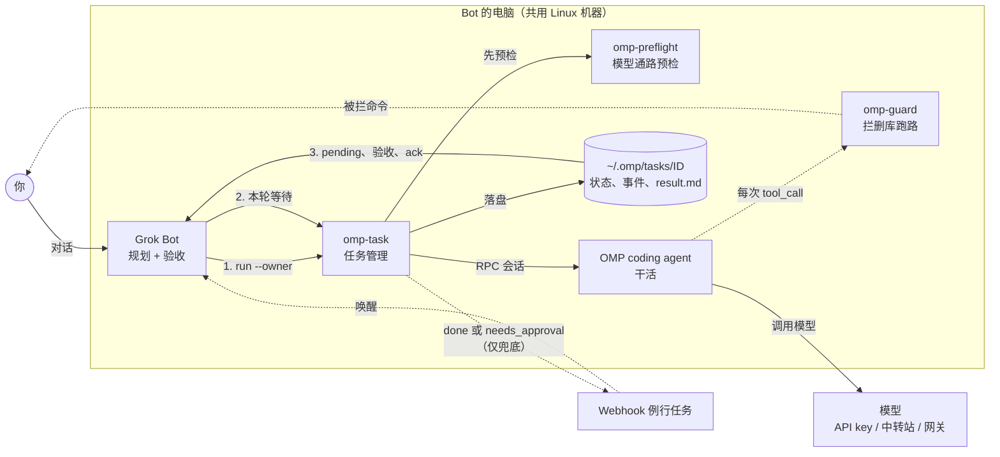

# GAO — Grokbot And Omp 详细设计文档

> 版本：v1.1  
> 状态：已实现（与仓库代码同步；修订见文末）  
> 蓝本：[`grokbot-and-pi`](../grokbot-and-pi/)（GAP）  
> 目标：在 Grok Bot 中用 **OMP**（[omp.sh](https://omp.sh)，Oh My Pi / 终端优先 coding agent）完整替换 Pi，实现与 GAP **功能完全对标** 的派活、追踪、验收、安全与韧性闭环。

---

## 1. 背景与目标

### 1.1 问题

Grok Bot 平台对话额度昂贵，适合做意图理解、任务拆解与代码审查；不适合反复读文件、改代码、跑测试等多步执行。GAP 已验证「Bot 规划 + 本机 subagent 执行」模式；本项目将该模式迁移到 **OMP**。

### 1.2 设计目标（对标 GAP）

| 目标 | 说明 |
| --- | --- |
| 额度分离 | Bot 只做规划与验收；重活由本机 OMP 消耗用户自有模型额度 |
| 同机执行 | OMP 与 Bot 同机，直接读写本地文件、执行 bash，无跨机同步 |
| 持久任务 | `omp-task` 提供可追踪、可续跑、可取消、可 ack 的任务生命周期 |
| 本轮等待 + Webhook 兜底 | 防宿主机睡眠冻住进程；通知仅唤醒，磁盘为唯一事实源 |
| 韧性 | 预检重连、空闲超时、孤儿进程检测、interrupted 续跑 |
| 安全 | `omp-guard` 灾难命令拦截 + 人机审批；高危操作永不派给 OMP |
| 自配置 | `AGENTS.md` + Skills + Routine 模板，Bot 可端到端自助装好 |

### 1.3 非目标

- 不把 OMP 做成跨机远程 worker（保持同机）。
- 不替代 Bot 做 git push / 付款 / 发帖 / 对外发信等不可逆操作。
- 不实现强沙箱（Docker/MicroVM）；需要时另行接入 OMP 官方 sandbox 扩展。
- 不要求与 GAP 共享同一任务存储目录或会话文件（命名空间独立，避免冲突）。

---

## 2. 与 GAP 的功能对标矩阵

下列能力必须在 GAO 中 **一一实现**，语义等价；仅运行时、路径、环境变量前缀、RPC 事件名随 OMP 调整。

| # | GAP 能力 | GAO 对标实现 | 验收标准 |
| --- | --- | --- | --- |
| F1 | `pi-task run/reply/status/list/log/cancel/pending/ack` | `omp-task` 同名子命令集合 | CLI 帮助与退出码语义一致 |
| F2 | `approve` / `deny` + `needs_approval` Webhook | 同名子命令 + 同结构 payload | 拦截→通知→用户裁决→续跑 |
| F3 | `pi-guard` 灾难命令拦截 | `omp-guard`（OMP extension，`tool_call`） | 同规则集 + 单测覆盖 |
| F4 | `pi-call.mjs` 单次 RPC | `omp-call.mjs` | 一发一收打印最终回复 |
| F5 | `pi-run` 同步快捷包装 | `omp-run` | 冒烟可跑通 |
| F6 | `pi-preflight` 模型通路预检 | `omp-preflight` | run/reply/approve/deny 前自动执行 |
| F7 | Owner 路由 + pending/ack 过滤 | 完全同语义 | 多 Bot 不串台 |
| F8 | 磁盘任务仓 `~/.pi/tasks/<ID>/` | `~/.omp/tasks/<ID>/` | 同文件集：status/events/result/prompts/approvals |
| F9 | Webhook 元数据通知 | `source: "omp-task"` | 不含 prompt/result/密钥 |
| F10 | 本轮 AwaitShell + Webhook 兜底 | 同一 Bot 行为规范（Skill） | 文档与 Skill 强制写明 |
| F11 | 空闲超时 idle-timeout | 同默认 300s | 无事件→failed + notify |
| F12 | 孤儿 PID → interrupted | 同逻辑 | status/list/pending 触发检测 |
| F13 | Session 互斥（同 session 仅一 running） | 同约束 | 冲突 exit 1 |
| F14 | 安装脚本 + AGENTS 7 步 | `install.sh` + `AGENTS.md` | Bot 可自助装好 |
| F15 | Skills：setup + dispatch | `grokbot-omp-setup` / `grokbot-omp-dispatch` | 意图与铁律对齐 |
| F16 | Routine 模板 | `routines/omp-task-notify.md` | 完成/审批双路径 |
| F17 | 额度文档（官方/中转/网关） | `docs/quota.md`（OMP 配置路径） | 三种接入可测通 |
| F18 | 安全文档 | `docs/security.md` | 规则与审批图完整 |
| F19 | CLI 参考 + setup-guide | 对应 docs | 覆盖环境变量与状态机 |
| F20 | Guard 单测 | `tests/omp-guard.test.mjs` | 拦截/放行用例齐全 |

---

## 3. 总体架构

### 3.1 逻辑架构



### 3.2 四步闭环（与 GAP 同构）

1. **派活**：Bot 写五要素任务书，Shell **后台**执行  
   `omp-task run <cwd> '<任务书>' --session <名> --owner <BOT_ID> --notify-prefix <BOT>`。
2. **本轮长等待**：不结束当前轮；用一次长时间阻塞 `AwaitShell`（约 13 分钟上限）等后台任务结束，防止宿主机睡眠冻住 OMP。
3. **Webhook 兜底**：轮次提前结束时，`omp-task` POST 轻量元数据叫醒 Routine。
4. **核验 + Ack**：读 `result.md`，亲自查 diff/产物/测试，汇报用户后  
   `omp-task ack <ID> --owner <BOT_ID>`。

> **磁盘是唯一事实来源。** Webhook 只降唤醒延迟；丢包后靠 `omp-task pending --owner <BOT_ID>` 恢复。

### 3.3 命名与路径对照

| 概念 | GAP | GAO |
| --- | --- | --- |
| 项目名 | GAP / grokbot-and-pi | GAO / grokbot-and-omp |
| Agent 二进制 | `pi` | `omp` |
| 任务 CLI | `pi-task` | `omp-task` |
| 安装目录 | `~/tools/pi-call` | `~/tools/omp-call` |
| 任务根目录 | `~/.pi/tasks` | `~/.omp/tasks` |
| 会话目录 | `~/.pi/agent/sessions/tasks` | OMP 原生 session store 下的 tasks 分区（见 §6.2） |
| Guard 扩展 | `extensions/pi-guard.ts` | `extensions/omp-guard.ts` |
| 通知 env | `<BOT>_PI_NOTIFY_URL/KEY` | `<BOT>_OMP_NOTIFY_URL/KEY` |
| 通用通知 env | `PI_NOTIFY_URL` / `PI_NOTIFY_SECRET` | `OMP_NOTIFY_URL` / `OMP_NOTIFY_SECRET` |
| 任务相关 env 前缀 | `PI_TASK_*` | `OMP_TASK_*` |
| Notify payload source | `"pi-task"` | `"omp-task"` |

---

## 4. 仓库目录结构（目标）

```text
grokbot-and-omp/
├── AGENTS.md                       # Bot 7 步自配置指南
├── README.md / README.zh-CN.md
├── LICENSE
├── install.sh                      # 安全安装（不删文件）
├── bin/
│   ├── omp-task                    # 入口：PATH、预检、转调 omp-task.mjs
│   ├── omp-task.mjs                # 任务生命周期核心
│   ├── omp-call.mjs                # 单次 RPC 客户端
│   ├── omp-run                     # 同步快捷包装
│   └── omp-preflight.example       # 模型通路预检模板
├── extensions/
│   └── omp-guard.ts                # tool_call 灾难命令拦截
├── skills/
│   ├── grokbot-omp-setup/
│   │   ├── SKILL.md
│   │   └── README.md
│   └── grokbot-omp-dispatch/
│       ├── SKILL.md
│       └── README.md
├── routines/
│   └── omp-task-notify.md          # Webhook Routine 提示词
├── docs/
│   ├── architecture.png / workflow.jpg / logo.png
│   ├── setup-guide.md
│   ├── omp-task-reference.md
│   ├── security.md
│   ├── quota.md
│   └── grokbot-and-omp-design.md   # 本文档
└── tests/
    └── omp-guard.test.mjs
```

安装落盘：`~/tools/omp-call/`（含 `bin/*` 与 `extensions/`），行为对齐 GAP 的 `install.sh`。

---

## 5. 组件详细设计

### 5.1 `omp-task` / `omp-task.mjs`（核心）

**职责**：在 `omp --mode rpc` 之上提供可追踪任务；与 `pi-task.mjs` 功能等价，RPC 适配层按 OMP 协议实现。

#### 5.1.1 子命令

```text
omp-task run <cwd> "<prompt>" --session <name> --owner <agent-id>
         [--timeout sec] [--idle-timeout sec] [--model provider/model]
         [--thinking off|low|medium|high|...] [--notify-prefix <name>]
         [--no-write] [--no-web] [--guard on|off]
omp-task reply <ID> "<prompt>" [--owner <id>] [--timeout sec] [--idle-timeout sec]
omp-task approve <ID> <req> [--owner <id>] [--timeout sec] [--idle-timeout sec]
omp-task deny <ID> <req> [--owner <id>] [--timeout sec] [--idle-timeout sec]
omp-task status <ID>
omp-task list [--all] [--owner <id>|none]
omp-task log <ID> [-n 30]
omp-task cancel <ID>
omp-task pending [--owner <id>|none]
omp-task ack <ID> [<ID>...] [--owner <id>|none]
```

#### 5.1.2 退出码（与 GAP 一致）

| Code | 含义 |
| --- | --- |
| 0 | done |
| 1 | failed / refused / 命令错误 |
| 2 | 用法错误 |
| 124 | 总超时 |
| 130 | cancelled |

#### 5.1.3 状态机

```text
queued → running → done | failed | cancelled | interrupted
```

- `running` 且 PID 不存在 → 操作类子命令标记 `interrupted`，写 `orphan_detected` 事件。
- `cancel`：对 runner PID 发 SIGTERM；12s 未结束则 SIGKILL，记 forced cancellation。
- 超时 / 信号：向 OMP 发 `abort`，最多等 5s，再落盘并退出。

#### 5.1.4 Owner 语义（完全对标）

- `run --owner` 写入 `status.json`；缺省读 `OMP_TASK_OWNER`；皆无则 `owner=null` 并 stderr 警告。
- Owner 禁止空白；`reply` 不可改 owner。
- `--owner none` 过滤无主任务（字面量 `none` 不得作为真实 Bot ID）。
- `ack` 带 owner 过滤时拒绝错主；多 ID 时匹配者仍 ack，有拒绝则 exit 1。
- Owner 是路由纪律，不是 OS 安全边界。

#### 5.1.5 通知

读取顺序：

1. `--notify-prefix NAME` → `NAME_OMP_NOTIFY_URL` + `NAME_OMP_NOTIFY_KEY`
2. 否则 `OMP_TASK_NOTIFY_PREFIX`
3. 否则 `OMP_NOTIFY_URL` + `OMP_NOTIFY_SECRET`
4. `OMP_NOTIFY_OFF=1` 或 URL/KEY 缺失 → 跳过发送

Payload（完成）：

```json
{
  "source": "omp-task",
  "id": "docs-20261113-091601",
  "owner": "YOUR_AGENT_ID",
  "state": "done",
  "exit_code": 0
}
```

审批：

```json
{
  "source": "omp-task",
  "id": "TASK_ID",
  "owner": "BOT_ID",
  "state": "needs_approval",
  "exit_code": null,
  "req": "REQ_ID",
  "command": "rm -rf /"
}
```

实现约束：

- 独立 detached 子进程发 HTTP POST；`Authorization: Bearer <key>`。
- 启动 OMP 子进程前 **剥离** 通知密钥与认证敏感 env；不得写入 events/result。
- notify 结果只记 `events.jsonl` 中的 `http <status>` / `error ...`。

#### 5.1.6 空闲超时与总超时

- `--timeout` 默认 300；`0` 关闭。
- `--idle-timeout` 默认 300（或 `OMP_TASK_IDLE_TIMEOUT`）：无新 RPC 事件则 failed + `error=idle timeout` + notify。
- 任意 stdout RPC 帧刷新 idle 计时器。

#### 5.1.7 预检挂钩

若存在可执行的 `omp-preflight`（旁路同目录或 `OMP_TASK_PREFLIGHT`）：

- 在 `run` / `reply` / `approve` / `deny` 真正拉起 OMP **之前**同步执行。
- 检测到模型连接类错误（如 `UND_ERR_SOCKET`、`ECONNRESET`、对端关闭）并触发 OMP 自动重试时，**并行**再跑一次预检。
- 事件类型：`preflight`（`ok` / `exit N` / `started after connection error`）。
- 预检 stderr 透传给操作者（重连诊断可见）。

#### 5.1.8 Session 互斥

- 同一 `session` 仅允许一个 `running` 或 `queued` 任务。
- `run` 占用中 session、对 running 任务 `reply` → 拒绝，exit 1。
- Task ID：`<session>-<YYYYMMDD-HHMMSS>`（本地时区生成；存储时间 ISO UTC）。
- `reply` / `approve` / `deny` 必须 `--resume` 已有会话（`session_file` 优先，否则 `omp_session_id`）；二者皆不可用则硬失败，禁止静默新开冷会话。

---

### 5.2 OMP RPC 适配层（相对 Pi 的差异点）

GAP 基于 `pi --mode rpc`；GAO 基于 `omp --mode rpc`。适配层必须按 OMP 文档实现，不能假设事件名与 Pi 完全相同。

| 主题 | 设计约定 |
| --- | --- |
| 启动 | `spawn(OMP_BIN \|\| "omp", ["--mode","rpc", ...])`；cwd = 任务工作目录 |
| 就绪 | 等待首帧 `{"type":"ready",...}` 后再发命令 |
| 发 prompt | `{"id","type":"prompt","message":"..."}` |
| 完成判据 | `agent_end` 且 `isTerminal !== false`；或本地处理时的 `agentInvoked:false` / `prompt_result` |
| 取消 | 发 `abort`，等待 abort response + terminal `agent_end` |
| 续跑 | `reply`/`approve` 在同一 session 再发 `prompt`（必要时 `abort_and_prompt`） |
| UI 请求 | 收到 `extension_ui_request` 立即 `extension_ui_response` cancelled（非交互宿主） |
| 协议版本 | 优先 negotiate v2（大帧重组）；失败可降级 v1 |
| 工具开关 | 通过 OMP CLI/RPC 等价能力映射 `--no-write` / `--no-web`（实现时对照当时 CLI：如 tools 白名单或 config） |
| 模型 | `--model provider/model` 或 `OMP_TASK_MODEL`；皆空则用 OMP 默认 |
| thinking | 透传 OMP 支持的档位；默认 `medium`（`OMP_TASK_THINKING`） |
| stderr | 永不并入 JSONL 解析；仅作诊断 |
| Guard 加载 | 启动参数或配置注入 `extensions/omp-guard.ts`；`OMP_GUARD=off` / `--guard off` 旁路 |

**实现建议**：从 GAP 的 `pi-task.mjs` / `pi-call.mjs` 复制任务仓、owner、notify、approve 状态机；仅替换「spawn + 事件解析 + 完成/中止」模块，并用针对 OMP 的集成测试锁定完成边界。

**参考伪流程（execute）**：

```text
preflight()
spawn omp --mode rpc (+ session-dir/session-id + guard extension + model/thinking/tools)
wait ready
send prompt
loop read JSONL:
  refresh idle timer
  append sanitized events
  if approvals.jsonl new lines → notify needs_approval
  if connection-error pattern → spawn preflight parallel
  if extension_ui_request → auto-cancel
  if agent_end terminal → break
on timeout/idle/signal → abort → wait ≤5s
write result.md (last assistant text)
update status.json atomically
notify(state, exit_code)
exit with mapped code
```

---

### 5.3 `omp-call.mjs` / `omp-run`

| 入口 | 行为 |
| --- | --- |
| `omp-call.mjs` | 一次性 RPC：prompt → 等 settled/agent_end → 打印最终回复；无任务仓 |
| `omp-run` | 同步包装：默认开启写/exec（及 web，除非关掉）、thinking 较高、固定或可配模型；便于冒烟 |

约束：与 `omp-task` 会话目录隔离，不可假设会话可互换恢复（对标 GAP）。

---

### 5.4 `omp-guard`（扩展）

**定位**：极窄拦截灾难性删除/抹盘；常规构建清理一律放行。规则集 **字节级对标** `pi-guard.ts`。

#### 拦截

1. `rm` + 递归（`-r`/`-R`/`--recursive`），且目标为危险集合：`/`、`/*`、`~`、`$HOME`、`/home`、`/root`、`/etc`、`/usr`、`/var`、`/boot`、`/opt`、`/bin`、`/lib`、`/workspace`、`..`、`*` 等。
2. `find` 从危险根出发且带 `-delete`。
3. `mkfs*`。
4. `dd` 且 `of=/dev/...`。

#### 放行

- `rm -rf ./build`、`node_modules`、`dist`、单文件删除等。
- 普通 `ls`/`cat`/`git`/`find . -name ... -delete` 等。

#### 审批闭环

```text
OMP tool_call → omp-guard block
  → 追加 $OMP_TASK_DIR_CURRENT/approvals.jsonl {req,command,reason,ts}
  → 返回 reason：已请求用户放行（req=…），先跳过，勿换写法绕过
omp-task 监视 approvals.jsonl → Webhook needs_approval
用户同意 → omp-task approve → 写入 approved.json 白名单 → prompt 续跑
用户拒绝 → omp-task deny → prompt 告知改用不删除方案
再次执行「命令字符串完全一致」→ 白名单放行
```

环境：

- `OMP_GUARD=off` 整体旁路。
- 任务目录通过 env（如 `OMP_TASK_DIR_CURRENT`）注入扩展，供写 approvals。

扩展 API：订阅 OMP 的 `tool_call`，返回 `{ block: true, reason }`（见 [Hooks](https://omp.sh/docs/hooks) / extension authoring）。

**局限声明**（写入 `docs/security.md`）：防君子不防小人；脚本间接删除、编码绕过无法覆盖；强隔离需 sandbox。

---

### 5.5 `omp-preflight`

复制 `pi-preflight.example` 逻辑，改名为 `omp-preflight.example`：

- 探测网关健康（例：期望短时内 401）。
- 检测睡眠后 Tailscale 假死（端口通、HTTP 挂）。
- 不健康则 down/up + 转发重启，轮询至就绪或超时仍 exit 1（调用方警告后继续）。
- 仅 stderr 输出；成功 exit 0。

---

### 5.6 Skills

#### `grokbot-omp-setup`

对标 `grokbot-pi-setup`：装 OMP、配模型、装 `omp-task`、配 Webhook 与 Secret 卡、冒烟。

完成三条：

1. `omp -p 'reply ok'`（或等价无会话探活）成功。
2. `~/tools/omp-call/omp-task` 可用 + Routine 可叫醒 Bot。
3. `<BOT>_OMP_NOTIFY_URL` / `<BOT>_OMP_NOTIFY_KEY` 已配置且不打印。

#### `grokbot-omp-dispatch`

对标 `grokbot-pi-dispatch`：五要素任务书、后台派活、本轮 AwaitShell、pending/验收/ack、needs_approval 铁律、interrupted 续跑、永不派高危操作。

任务书五要素（不变）：

1. 做什么（含背景；OMP 无聊天上下文）
2. 产物绝对路径
3. 可检查完成标准
4. 严格边界（目录、禁删、禁 push）
5. 收尾（自查一次即停）

---

### 5.7 Webhook Routine

`routines/omp-task-notify.md` 对标 `pi-task-notify.md`：

0. `needs_approval` → 原样展示 command → 仅用户裁决 → `approve`/`deny`  
1. `omp-task pending --owner <BOT_ID>`  
2. 空则安静结束  
3. 逐任务：status → result.md → 亲自核验 → 汇报 → ack  
4. 铁律：不碰他主、不改 store 文件、不打印密钥、不自动重跑、不擅自放行

多 Bot：他主任务 `SendToAgent` 转发；无主任务仅告知用户。

---

### 5.8 `AGENTS.md` 七步（对标）

1. 检查/安装 OMP（按官方安装方式；验证 `omp --version`）
2. 配置模型额度（用户确认来源；探活）
3. 克隆仓库 + `./install.sh` → `~/tools/omp-call`
4. 创建 Webhook Routine（替换 `<BOT_ID>`）
5. 用户用 Secret 卡录入 `<BOT>_OMP_NOTIFY_*`（严禁聊天明文）
6. 加载两个 Skills
7. E2E 冒烟：写 `/tmp/gao-smoke.txt` → AwaitShell → pending → 验文件 → ack → pending 空

---

## 6. 数据与存储设计

### 6.1 任务仓

- Root：`$OMP_TASK_DIR`，默认 `~/.omp/tasks`
- 每任务目录：`$OMP_TASK_DIR/<ID>/`

| 文件 | 内容 |
| --- | --- |
| `status.json` | 原子写（tmp + rename） |
| `events.jsonl` | `{ts,type,tool?,text?}`；text 单行化截断 500 |
| `result.md` | 最后一轮助手文本；无文本则缺失 |
| `prompt-N.txt` | 第 N 轮 prompt |
| `approvals.jsonl` | guard 拦截请求 |
| `approved.json` | 已批准命令白名单 |

`status.json` 字段（对标 GAP，字段名保持一致便于迁移心智）：

```json
{
  "id": "docs-20261113-091601",
  "session": "docs",
  "owner": "YOUR_AGENT_ID",
  "cwd": "/home/me/repo",
  "model": "provider/model",
  "state": "done",
  "pid": null,
  "created_at": "...",
  "started_at": "...",
  "ended_at": "...",
  "exit_code": 0,
  "error": null,
  "reported": false,
  "notify_prefix": "GROKBOT",
  "runs": [
    {
      "n": 1,
      "prompt": "...",
      "started_at": "...",
      "ended_at": "...",
      "exit_code": 0
    }
  ],
  "options": {
    "thinking": "medium",
    "write": true,
    "web": true,
    "guard": "on"
  }
}
```

### 6.2 OMP 会话存储

- 通过 CLI 旗标或配置，将任务会话落到独立分区（建议环境变量 `OMP_TASK_SESSION_DIR`），避免与交互式 `omp` 会话混用。
- 具体目录以 OMP 当版 session 布局为准；设计要求：**任务会话可 resume（reply）**，且与 `omp-run` 默认会话隔离。

### 6.3 与 GAP 并存

允许同机同时安装 GAP 与 GAO：

- 工具目录、任务根、env 前缀均不同 → 无冲突。
- Bot Skills 需明确当前派活目标是 Pi 还是 OMP，避免混用命令。

---

## 7. 环境变量一览

| 变量 | 默认 | 用途 |
| --- | --- | --- |
| `OMP_TASK_DIR` | `~/.omp/tasks` | 任务仓 |
| `OMP_TASK_SESSION_DIR` | （OMP tasks 分区） | 任务会话目录 |
| `OMP_TASK_OWNER` | 空 | run 默认 owner |
| `OMP_TASK_MODEL` | 空 | 默认模型 |
| `OMP_TASK_THINKING` | `medium` | 默认思考档 |
| `OMP_TASK_IDLE_TIMEOUT` | `300` | 空闲超时秒 |
| `OMP_TASK_PREFLIGHT` | 旁路 `omp-preflight` 若存在 | 预检脚本 |
| `OMP_TASK_NOTIFY_PREFIX` | 空 | 默认 notify 前缀 |
| `OMP_NOTIFY_URL` | 空 | 无前缀时的 webhook |
| `OMP_NOTIFY_SECRET` | 空 | Bearer token |
| `OMP_NOTIFY_OFF` | 空 | `1` 关闭通知 |
| `OMP_BIN` | `omp` | 可执行文件 |
| `OMP_GUARD` | on | `off` 关闭 guard |
| `OMP_TASK_DIR_CURRENT` | （runner 注入） | 当前任务目录给扩展 |
| `OMP_TASK_HOME` | `~/tools/omp-call` | install 目标（install.sh） |
| `<BOT>_OMP_NOTIFY_URL` | — | 多 Bot 专用 URL |
| `<BOT>_OMP_NOTIFY_KEY` | — | 多 Bot 专用 Key |

---

## 8. 安全与权限边界

### 8.1 永不派给 OMP

删除重要文件、发消息/邮件、付款、公开发帖、`git push`、部署到生产 —— **Bot 在用户确认后亲自做**。

### 8.2 密钥卫生

- 通知密钥只用 Secret 卡 / 环境变量；不进仓库、不进聊天、不进任务日志。
- OMP 认证文件（若有本地 auth store）禁止 Bot/子 agent 读取打印。
- 子进程环境剥离通知密钥。

### 8.3 Guard + 人机审批

见 §5.4；Routine/Skill 写明：**Bot 严禁擅自 approve**。

### 8.4 工作目录最小化

派活 cwd 选项目目录或 `/tmp/<名>`，禁止 `/` 或整个 `$HOME`。

---

## 9. 模型额度（quota）

对标 GAP 三方案，配置面改为 OMP：

| 方案 | 做法 |
| --- | --- |
| A. 官方 / OpenAI 兼容 | `omp` 登录或配置 provider；`omp -p` 探活 |
| B. 自建网关（如 Magpie） | 仅听 Tailscale 内网 + Token；OMP provider 指内网 baseUrl |
| C. OMP 已有默认 | 省略 `--model`，用默认额度 |

派活时可 `--model provider/model` 覆盖。网关场景强烈建议配置 `omp-preflight`。

合规提示：订阅转 API 可能违反 TOS，建议专用号。

---

## 10. Bot 运行时行为规范（强制写入 Skill）

1. `run` 必须用 Shell **后台模式**（不用 `nohup`/`&`/`setsid`）。
2. 派出后告知用户，**不结束本轮**；一次长 `AwaitShell` 等结束。
3. 等不完可再等；用户插话先回复再继续等。
4. Webhook 仅兜底；醒来先 `pending`。
5. 验收：`result.md` 只是声称；必须亲自验产物。
6. 失败/超时/interrupted：不自动盲目重跑；问用户；interrupted 则 cancel（如需）+ `reply` 续跑。
7. 补充要求优先 `reply` 同会话，不新开任务（除非 session 冲突）。
8. 回复语言跟随用户偏好。

---

## 11. 安装与部署

### 11.1 依赖

- Node.js ≥ 22（`omp-task.mjs` 无第三方依赖，与 GAP 一致）。
- 已安装并可执行的 `omp`（安装方式以 [omp.sh docs](https://omp.sh/docs) 为准）。

### 11.2 `install.sh` 行为

1. 检查 `node` 主版本 ≥ 22。  
2. 检查 `omp` 在 PATH。  
3. `mkdir -p ~/tools/omp-call`，复制 `bin/*` 与 `extensions/*`（**绝不删除**已有文件）。  
4. `chmod +x` 可执行入口。  
5. 打印 PATH、冒烟与 Secret 配置指引。

### 11.3 冒烟

```bash
OMP_NOTIFY_OFF=1 ~/tools/omp-call/omp-task run /tmp 'Reply with only OK' \
  --session smoke --owner <BOT_ID>
# STATE done 后
~/tools/omp-call/omp-task ack <TASK_ID> --owner <BOT_ID>
```

E2E（含产物）：

```bash
~/tools/omp-call/omp-task run /tmp \
  "在 /tmp/gao-smoke.txt 中写入 gao-ok 并自查结束" \
  --session smoke-gao --owner <BOT_ID> --notify-prefix <BOT>
# AwaitShell → pending → cat /tmp/gao-smoke.txt → ack
```

---

## 12. 测试计划

| 层级 | 内容 |
| --- | --- |
| 单测 | `omp-guard`：危险命令拦截、安全命令放行、复合命令拆分、白名单放行 |
| 契约测 | RPC 适配：ready → prompt → agent_end；abort；extension_ui 自动取消 |
| 集成 | `OMP_NOTIFY_OFF=1` 下 run→status→ack；reply 续跑；cancel；idle-timeout；orphan→interrupted |
| 审批 | 模拟写入 approvals → needs_approval notify → approve/deny |
| E2E | AGENTS 第 7 步全链路（可在 Bot 电脑手工） |
| 回归对标 | 用同一任务书分别在 GAP/GAO 跑，对比状态机与验收流程（不要求字节相同输出） |

---

## 13. 实现分期建议

| 阶段 | 交付 | 对标功能 |
| --- | --- | --- |
| P0 | `omp-call` + `omp-run` + RPC 探活 | F4 F5 |
| P1 | `omp-task` 基础：run/status/list/log/cancel + 任务仓 | F1（部分）F8 |
| P2 | owner / pending / ack / notify / reply | F1 F7 F9 |
| P3 | idle-timeout / preflight / orphan interrupted / session 互斥 | F6 F11 F12 F13 |
| P4 | `omp-guard` + approve/deny + needs_approval | F2 F3 F20 |
| P5 | install.sh、AGENTS、Skills、Routine、docs | F14–F19 |
| P6 | 全量对标验收与 README 双语 | 全部 F1–F20 |

建议：**以 `grokbot-and-pi` 源码为骨架做机械替换 + RPC 适配**，优先保证状态机与 CLI 表面稳定，再打磨 OMP 特有旗标映射。

---

## 14. 风险与开放点

| 风险 | 缓解 |
| --- | --- |
| OMP RPC 事件/旗标随版本变化 | 锁定最低支持版本；适配层集中；加契约测试 |
| tools/`--no-write`/`--no-web` 映射方式与 Pi 不同 | 实现前对照当版 CLI/RPC；在 reference 文档写清实际旗标 |
| Session 目录布局与 Pi 不同 | `OMP_TASK_SESSION_DIR` 抽象；reply 用 session-id 而非假设路径兼容 |
| 同机 GAP+GAO 用户混淆 | README 醒目区分命令与 env；Skill 名称带 `omp` |
| Guard 扩展加载方式 | install 复制到 `~/tools/omp-call/extensions`；runner 显式加载路径 |

开放决策（实现前确认一次即可）：

1. OMP 最低版本号（写入 README / install 检查）。  
2. 任务会话具体 CLI 参数名（`--session-dir` / `--session-id` 等以当版为准）。  
3. thinking 枚举是否完整暴露 OMP 全部档位（建议暴露，默认仍 `medium`）。

---

## 15. 成功标准（Definition of Done）

1. F1–F20 对标矩阵全部勾选。  
2. Bot 仅凭 `AGENTS.md` 可完成安装与冒烟。  
3. 派活→本轮等待或 Webhook→pending→亲自验收→ack 闭环稳定。  
4. Guard 单测通过；灾难命令进入审批而非直接抹盘。  
5. 通知不含 prompt/result/密钥；子进程环境无通知密钥。  
6. 文档（setup / reference / security / quota / routine / skills）齐备且与实现一致。

---

## 附录 A：GAP → GAO 符号速查

| GAP | GAO |
| --- | --- |
| `pi` | `omp` |
| `pi-task` | `omp-task` |
| `pi-call.mjs` | `omp-call.mjs` |
| `pi-run` | `omp-run` |
| `pi-preflight` | `omp-preflight` |
| `pi-guard` | `omp-guard` |
| `~/tools/pi-call` | `~/tools/omp-call` |
| `~/.pi/tasks` | `~/.omp/tasks` |
| `PI_*` | `OMP_*` |
| `<BOT>_PI_NOTIFY_*` | `<BOT>_OMP_NOTIFY_*` |
| `grokbot-pi-*` skills | `grokbot-omp-*` skills |
| `source: pi-task` | `source: omp-task` |
| GAP / grokbot-and-pi | GAO / grokbot-and-omp |

## 附录 B：蓝本关键文件索引

| 蓝本路径 | 用途 |
| --- | --- |
| `grokbot-and-pi/bin/pi-task.mjs` | 任务状态机、notify、approve、idle、orphan |
| `grokbot-and-pi/bin/pi-call.mjs` | 单次 RPC |
| `grokbot-and-pi/extensions/pi-guard.ts` | Guard 规则与审批写盘 |
| `grokbot-and-pi/skills/*` | Bot 行为规范 |
| `grokbot-and-pi/routines/pi-task-notify.md` | Webhook 提示词 |
| `grokbot-and-pi/AGENTS.md` | 自配置七步 |
| `grokbot-and-pi/docs/*` | 文档结构模板 |
| `grokbot-and-pi/tests/pi-guard.test.mjs` | Guard 测试模板 |

---

*本文档是实现 `grokbot-and-omp` 的唯一功能规格来源：实现功能必须完全对标 GAP；与 OMP 相关的差异仅允许出现在 RPC/CLI/路径/环境变量适配层。*

---

## 修订记录

| 版本 | 说明 |
| --- | --- |
| v1.0 | 初稿（设计定稿） |
| v1.1 | 与实现同步：`agentInvoked:false` 完成边界；resume 优先 `session_file` 否则 `omp_session_id`，缺失则硬失败；agent 轮次无助手文本视为 failed；session 互斥含 `queued`；preflight 覆盖 deny 且透传 stderr；`deny` 校验 req；去掉错误的 `PI_NOTIFY_OFF` 示例 |
