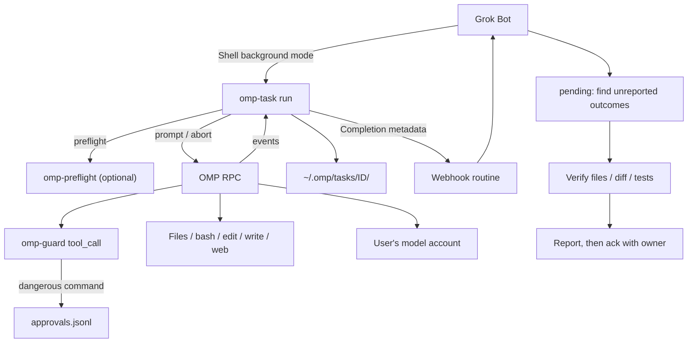

# Delegate work from Grok Bot to OMP: setup guide

[Project overview](../README.md) · [中文简介](../README.zh-CN.md)

Prerequisites: a Grok Bot Linux computer with shell access, routines that can be
triggered by webhook, and a secure facility for supplying environment variables.
UI labels and available features may vary. OMP runs on that same cloud computer,
not on your personal laptop. User-facing replies should use the user's language.

The goal: delegate heavy file processing, coding, drafts, or research to OMP on
the local machine. The Bot waits in the current turn using a long blocking wait
to inspect and report results immediately upon completion (preventing host sleep
from freezing OMP), while Webhook routines serve as a reliable fallback.

---

## 1. Lifecycle

The Bot starts `omp-task` with its Shell tool's background mode. `omp-task`
starts `omp --mode rpc` and exchanges JSONL over stdin/stdout. Status, events,
prompts and results are saved under `~/.omp/tasks/<ID>/`; the OMP session file
is recorded in `status.json` and reused for `reply`.



- **Start**: stdout begins with `TASK <ID>`. Supply `--owner YOUR_AGENT_ID` so
  the completion can be routed back to the dispatching Bot. The fallback is
  `OMP_TASK_OWNER`; without either, owner is null and the command warns.
- **Execute**: OMP works in the specified directory and records its progress.
  The guard extension is loaded automatically (`-e extensions/omp-guard.ts`).
- **Finish**: the final reply is written to `result.md`, when available. The
  notifier POSTs only `{source, id, owner, state, exit_code}`, never the prompt
  or result.
- **Wake**: the receiving Bot examines pending tasks and their owners, verifies
  its own results, reports them and runs `ack` with its own owner ID.
- **Recover**: notifications are best-effort. Disk state remains authoritative.

A background shell command finishing does not itself guarantee a new Bot turn.
To avoid having the host computer sleep and freeze OMP, the Bot should stay in
the current turn using a long blocking wait (such as `AwaitShell`) rather than
exiting immediately. Webhook routines provide a reliable wakeup if the turn does
end. Webhooks can also be missed; check `pending` on subsequent wakeups rather
than re-executing the task.

---

## 2. Install OMP and authenticate

Run commands on the Bot computer. Check existing tools before installing.

### 2.1 Node 22+ and OMP

The `omp-task` / `omp-call` wrappers need Node.js >= 22. OMP itself is a
standalone binary installed by its official installer.

```bash
node --version                 # must be >= 22
curl -fsSL https://omp.sh/install | sh
omp --version
```

If `omp` is not found after installation, follow the installer's PATH
instructions and open a new shell.

### 2.2 Model login: user-operated

Run `omp` in an interactive terminal and enter `/login`. Select the provider
supported by your installation, then complete browser authorization. If
instructed, paste the authorization code or callback URL into the login
terminal — not into the Bot conversation.

OMP stores credentials in its own agent directory (`~/.omp/agent/`). Do not have
the Bot or delegated agent inspect, print or copy credential databases, and do
not print `models.yml` values that contain real keys.

For API-key/relay/gateway providers, see [quota.md](quota.md). The important
checks are:

```bash
omp -p 'Reply with only OK' --no-session
omp -p 'Reply with only OK' --no-session --model <provider>/<model>
```

`omp models` or `omp models <provider>` lists model metadata without
displaying credentials; listing a model does not prove that a request will
authenticate. Use the smoke test to verify actual execution.

`omp-task` uses OMP's configured default model if `--model` is omitted, or reads
`OMP_TASK_MODEL`, or accepts an explicit `run --model provider/model`. `omp-run`
uses the default model unless `OMP_RUN_MODEL` is set.

### 2.3 Copy the scripts

From the repository root:

```bash
./install.sh
```

This installs to `~/tools/omp-call` (override with `OMP_TASK_HOME`) and never
deletes existing files. Equivalent manual copy:

```bash
mkdir -p ~/tools/omp-call
cp -a bin/. ~/tools/omp-call/
cp -a extensions ~/tools/omp-call/
chmod +x ~/tools/omp-call/omp-run ~/tools/omp-call/omp-call.mjs \
         ~/tools/omp-call/omp-task ~/tools/omp-call/omp-task.mjs
```

| Entry point | Purpose |
| --- | --- |
| omp-call.mjs | One-shot RPC client. Sends a prompt, waits for `prompt_result`, prints the final reply. |
| omp-run | Synchronous shortcut with write/exec tools, high thinking and OMP's default (or `OMP_RUN_MODEL`) model. |
| omp-task + omp-task.mjs | Persistent task IDs, ownership, events/results, follow-up, cancellation and notifications. |
| omp-preflight.example | Optional model-path probe/reconnect template. |

The wrappers locate .mjs files beside themselves and add `~/.local/bin`,
`~/.bun/bin` and `~/.omp/agent/bin` to PATH. Keep the files together and ensure
node and omp can be found. See the [CLI reference](omp-task-reference.md) for
task storage, session resume and RPC details.

### 2.4 Smoke test

```bash
~/tools/omp-call/omp-run /tmp "Reply with only OK" --timeout 120
echo "exit=$?"
```

Expect OK on stdout and exit=0. If it fails, check Node/OMP availability, model
access and the error message; for tracked tasks also check task-store
permissions.

---

## 3. Create the webhook routine

Create a webhook-triggered routine in the Bot's routine interface, using a name
such as “OMP task completion”. Paste the instructions from
[the routine template](../routines/omp-task-notify.md), replacing `<BOT_ID>`
with the receiving Bot's actual ID.

The template distinguishes these cases:

1. Your tasks: verify the result, report it to the user, then ack with your owner ID.
2. Approval requests (`needs_approval`): show the exact command to the user and
   wait for a human decision; then `approve` or `deny`. The Bot must never
   approve on its own.
3. Another Bot's tasks: forward ID/owner/state to that Bot using SendToAgent with
   priority true; do not inspect, report or ack on its behalf. If the routine
   cannot forward messages, return the routing information to the main Bot.
4. Unowned tasks: tell the user the owner is missing; do not verify or ack.

The metadata-only notification cannot describe what the task actually did. Read
`pending`/`status` and the result files. The Bot's own ID can be found in its
profile path, such as `/home/box/agent-data/agents/YOUR_AGENT_ID/profile.json`.

---

## 4. Supply notification credentials securely

Find the routine's webhook URL and key in the host interface. For multi-Bot
setups, prefix variables with your bot identifier (e.g.,
`<BOT>_OMP_NOTIFY_URL` and `<BOT>_OMP_NOTIFY_KEY`):

| Variable | Value |
| --- | --- |
| `<BOT>_OMP_NOTIFY_URL` (or `OMP_NOTIFY_URL`) | Webhook endpoint URL |
| `<BOT>_OMP_NOTIFY_KEY` (or `OMP_NOTIFY_SECRET`) | Raw Bearer token/key, without a Bearer prefix |
| `OMP_TASK_OWNER` | Optional default dispatching Bot ID; explicit `--owner` is preferable |

Pass `--notify-prefix <BOT>` when invoking `omp-task run`. The runner reads
`<BOT>_OMP_NOTIFY_URL` and `<BOT>_OMP_NOTIFY_KEY` automatically and removes
notification secrets from the OMP child's environment.

- Do not put secrets in scripts, task files, a repository, prompts or
  command-line arguments.
- Verify the endpoint accepts `Authorization: Bearer ...`; do not confuse a
  Bearer token with a provider-specific signing secret.
- The Bot shell must inherit these environment variables. The notifier skips
  sending if either URL or key is absent, or `OMP_NOTIFY_OFF=1`.
- The secret is sent in the Authorization header, not recorded in task metadata.

---

## 5. End-to-end check

Replace `YOUR_AGENT_ID`, `<BOT>` and `TASK_ID` below; they are placeholders, not
literal IDs. Use the Bot Shell tool's own background mode for the run command,
not nohup, `&` or setsid.

```bash
[ -n "${GROKBOT_OMP_NOTIFY_URL:-}" ] && [ -n "${GROKBOT_OMP_NOTIFY_KEY:-}" ] && echo env-ok

~/tools/omp-call/omp-task run /tmp \
  "Create /tmp/omp-e2e if needed, write hello to /tmp/omp-e2e/out.txt, then reply done" \
  --session e2e --owner YOUR_AGENT_ID --notify-prefix GROKBOT --timeout 180 \
  > /tmp/omp-e2e.log 2>&1
```

In another shell action, inspect the first line to obtain the task ID:

```bash
head -1 /tmp/omp-e2e.log
~/tools/omp-call/omp-task status TASK_ID
grep notify ~/.omp/tasks/TASK_ID/events.jsonl
```

| Check | Expected |
| --- | --- |
| Task record | state=done, exit_code=0 in status.json, correct owner, `session_file` recorded, result.md present |
| events.jsonl | `ready` → protocol v2 (or v1) → `prompt_result` → `task_end`; a `notify` event, typically `http 200` |
| Routine | Wakes and reports verified task ID, status, conclusion and artifact location |
| pending | Task disappears after report + ack; `reported=true` in status |

The human-readable `status` command does not print exit_code directly; inspect
`status.json` when that field is needed. Do not edit it manually.

If no notification arrives, check environment availability and the routine's
configuration privately. The task result is still on disk. Use `pending` to
finish reporting; a failed notification is not a reason to rerun the task.

---

## 6. Install the Bot skills

Install [skills/grokbot-omp-dispatch/SKILL.md](../skills/grokbot-omp-dispatch/SKILL.md)
and [skills/grokbot-omp-setup/SKILL.md](../skills/grokbot-omp-setup/SKILL.md) using your host's
skill mechanism, or include their rules in the Bot's instructions. They cover:

- Short, self-contained prompts with input/output paths and acceptance criteria.
- Explicit owner IDs, background mode, and waiting in-turn with a blocking wait.
- Checking `pending` on wakeup, independently verifying results and owner-filtered ack.
- Continuing with `reply` in the same task/session rather than starting over.
- Human-only approval of `needs_approval`; never auto-approve.
- Keeping credential access, publishing, deployment and other sensitive actions
  out of delegated work.

English instructions do not require English replies: the Bot and OMP should use
the user's preferred language unless the task explicitly requests another.

---

## 7. Command summary

| Command | Behavior |
| --- | --- |
| run cwd prompt --session name --owner id | Creates a task; prints TASK ID, then STATE and RESULT on completion |
| reply ID prompt | Follows up in the same OMP session/directory with the same owner/options |
| approve ID req | Whitelists the exact blocked command and resumes with a release message |
| deny ID req | Resumes with a refusal message; nothing is whitelisted |
| status ID | Displays state, owner, model, directory, timing, runs, session file and recent events |
| list [--all] [--owner id\|none] | Running and recent tasks, optionally owner-filtered |
| log ID [-n 30] | Recent events |
| cancel ID | SIGTERM, then forced cancellation after 12 seconds if needed |
| pending [--owner id\|none] | Terminal tasks not yet reported |
| ack ID [ID...] [--owner id\|none] | Marks reported; with a filter, refuses mismatched owners |

`run` supports `--timeout` (default 300 seconds; 0 disables it), `--idle-timeout`
(default 300), `--model`, `--thinking`, `--no-write`, `--no-web` and
`--guard on|off`. Exit codes: 0 done, 1 failed/refused, 2 usage error, 124
timeout, 130 cancelled. See the reference for storage and recovery details.

---

## 8. Troubleshooting

- **After a restart**, home storage may take time to become available. Check
  `ls ~/tools/omp-call/` before repeatedly launching tasks. Operational
  subcommands detect formerly running tasks whose process has disappeared and
  mark them `interrupted`.
- **Missing tasks**: a test `OMP_TASK_DIR` may still be set. `unset OMP_TASK_DIR`
  returns to `~/.omp/tasks`; do not discard the alternative store's results.
- **Session not resuming**: inspect `session_file` / `omp_session_id` in
  `status.json`. Follow-ups prefer `--resume` on the session file, then fall
  back to the session id. If the file is gone a `session_missing` event is
  recorded; if neither target is usable, `reply`/`approve`/`deny` **fail hard**
  instead of silently starting a cold session. Start a new `--session` only when
  you intentionally abandon the old context.
- **Rotated webhook key**: update `<BOT>_OMP_NOTIFY_KEY` via secure input and
  repeat an explicitly authorized smoke test.
- **No notification**: inspect `notify` events and `pending`; do not
  automatically rerun.
- **Occupied session**: only one `running` or `queued` task per session is
  allowed. Check `status`, `cancel` if appropriate, or choose a different
  session.
- **Timeout / idle timeout**: split work or increase `--timeout` /
  `--idle-timeout`. Failed work needs a verified reason and user approval before
  retrying; avoid repeated empty calls.
- **Connection errors after sleep**: configure `omp-preflight` or probe the
  gateway health endpoint manually before `reply`. Do not blindly retry.
- **Guard blocked a command**: show the exact command and `req` to the user;
  only the user decides `approve`/`deny`.
- **OMP version too old**: verify `omp --version`; this project is tested with
  `18.18.9` and requires `prompt_result`, `negotiate_protocol`, `get_state` and
  the extension `tool_call` hook. Upgrade OMP if RPC frames are missing.
- **`omp` cannot find a model**: check `models.yml`/login and run
  `omp -p 'Reply with only OK' --no-session` directly.
